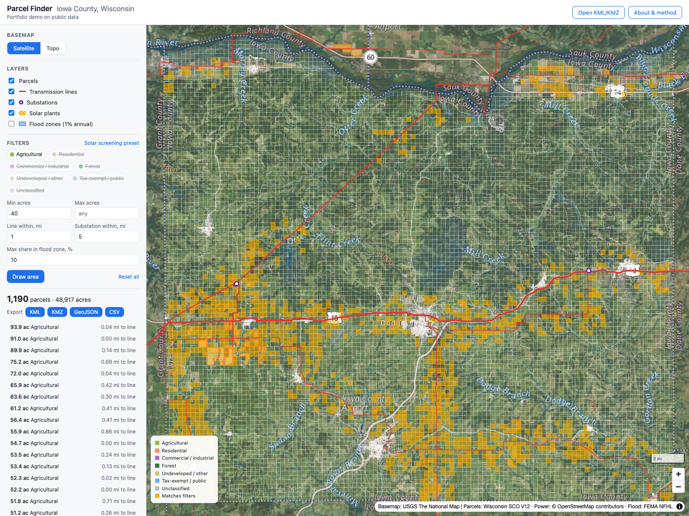

# Parcel Finder · Iowa County, Wisconsin

**Live map: https://skipkaev1999-sketch.github.io/parcel-finder/**



A web map for screening land parcels near grid infrastructure. It shows 31,740 real parcels with their distance to the nearest transmission line and substation and the share of each parcel inside the 1% annual chance flood zone. You can filter, draw an area, open a parcel card and export the selection to KML, KMZ, GeoJSON or CSV. KML and KMZ files can also be opened on top of the map.

It is a static site with no server and no API keys. Everything runs in the browser from one 9.7 MB PMTiles file and a few JSON files.

Portfolio demo on public data. Owner names and addresses are left out on purpose.

## How it is built

**Data preparation** (`prep/`, run once on a laptop)

1. `01_download_parcels.py` downloads the county's parcels from the Wisconsin statewide parcel service (V12, 2026).
2. `02_download_context.py` downloads transmission lines, substations and solar plants from OpenStreetMap (Overpass API) and 1% flood zones from the FEMA flood layer.
3. `03_load_postgis.sh` starts PostGIS 3.5 in Docker and loads every layer projected to NAD83 / Wisconsin Transverse Mercator (EPSG:3070), so all maths is done in metres.
4. `04_process.sql` repairs invalid geometry, computes acres, finds the nearest line and substation with a GiST index nearest-neighbour search (`<->`), and measures how much of each parcel lies in the flood zone.
5. `05_export.sh` exports the results to GeoJSON in WGS84.
6. `06_build_site_data.py` writes a compact table for filtering in the browser and splits full-precision geometry into an 8×8 grid, so an export downloads only the pieces it needs.
7. `07_tiles.sh` builds one PMTiles file with tippecanoe, keeping shared parcel borders aligned when simplifying.

**Front end** (`site/`): MapLibre GL JS 4.7 with the PMTiles protocol and plain JavaScript, no build step. Filters run over the compact table and are applied to the map as style expressions. KML export keeps a folder and a style per land-use group and writes every attribute into `ExtendedData`. Import reads KML or KMZ with togeojson and fflate.

**Hosting**: GitHub Pages, deployed by `.github/workflows/pages.yml`. PMTiles relies on HTTP range requests, which Pages supports.

## Accuracy check

- Computed acres match the state's own GIS acres with a median difference of 0.000%; 99% of parcels are within 0.02%.
- Distances in EPSG:3070 differ from ellipsoid distances by 0.04% on average (maximum 0.047% on a 3,000-parcel sample).
- The same distances computed in raw latitude/longitude degrees would be off by 2.7% on average and by up to 36.8% east–west, because at 43° N a degree of longitude is about 27% shorter than a degree of latitude.
- The parcels add up to 487,821 acres, close to the county's land area.

## Rebuild

Needs Docker, Python 3, QGIS (for `ogr2ogr`) and `brew install tippecanoe`.

```bash
DATA=/tmp/parcel-data; mkdir -p $DATA/out
python3 prep/01_download_parcels.py $DATA/parcels_raw.geojson
python3 prep/02_download_context.py $DATA
prep/03_load_postgis.sh $DATA
docker exec -i parcelmap-pg psql -U postgres -d parcels -v ON_ERROR_STOP=1 < prep/04_process.sql
prep/05_export.sh $DATA/out
python3 prep/06_build_site_data.py $DATA/out site
prep/07_tiles.sh $DATA/out "$PWD/site"
docker rm -f parcelmap-pg
```

## Data sources

- Parcels: Wisconsin Statewide Parcel Map Initiative V12, State Cartographer's Office and Wisconsin Land Information Program. Collected January–May 2026, tax roll 2025. Provided free of charge with no warranty; parcel lines do not represent legal ownership boundaries.
- Transmission lines, substations, solar plants: © OpenStreetMap contributors, ODbL.
- Flood zones: FEMA National Flood Hazard Layer, as republished by the Wisconsin Department of Health Services.
- Basemaps: USGS The National Map.
